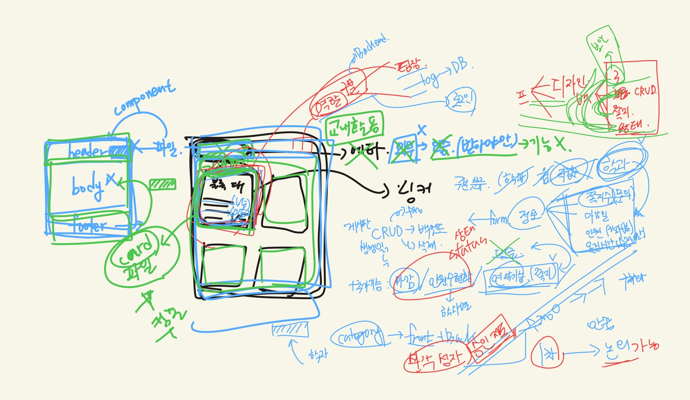

# 회의록

## 📅 2026-09-28 회의 요약

- **결정**:
  - 주제: 교내 수업/공모전/해커톤 팀원 모집 플랫폼
  - 개발 방식 및 범위: 단순 CRUD 기능 중심으로 MVP를 먼저 1차 완성 후 추가 기능 덧붙이기
  - 역할 분담 방식: 기능별 풀스택 분담
  - 작업 환경: 권기영의 GitHub Repository 사용, 협업 위한 Git Branch 규칙 수립(main / develop / feature-)
  - 기능 목록: 회원/인증, 모집/검색(CRUD, 필터링, 권한), 지원/승인(Form), 알림(지원 결과, 승인/거절, 모집 마감)
- **권기영 할 일**:
  - GitHub 세팅 [완료]
  - 지원/승인 기능
  - 알림 기능
- **김희서 할 일**:
  - 회원/승인 기능
  - 모집/검색 기능
- **이슈/참고**:
  > 
  > 그림1: 회의 중 초기 스케치
