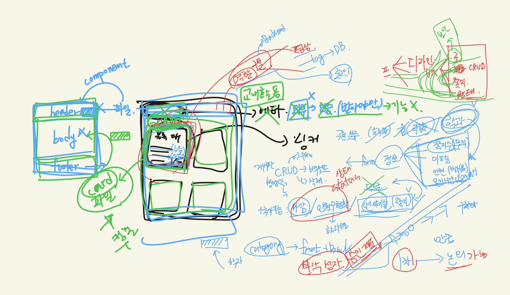

# 회의록

## 📅 2026-09-28 회의 요약

- **결정**:
  - 주제: 교내 수업/공모전/해커톤 팀원 모집 플랫폼
  - 개발 방식 및 범위: 단순 CRUD 기능 중심으로 MVP를 먼저 1차 완성 후 추가 기능 덧붙이기
  - 역할 분담 방식: 기능별 풀스택 분담
  - 작업 환경: 권기영의 GitHub Repository 사용, 협업 위한 Git Branch 규칙 수립(main / develop / feature-)
  - 기능 목록: 회원/인증, 모집/검색(CRUD, 필터링, 권한), 지원/승인(Form), 알림(지원 결과, 승인/거절, 모집 마감)
- **권기영 할 일**:
  - GitHub 세팅 [완료]
  - 지원/승인 기능 [완료]
  - 알림 기능 [완료]
- **김희서 할 일**:
  - 회원/인증 기능 [완료]
  - 모집/검색 기능 [완료]
- **이슈/참고**:
  > 
  > 그림1: 회의 중 초기 스케치

## 📅 2026-11-06 회의 요약

- **결정**:
  - 수업 프로젝트 가이드라인(Minimum Technical Requirements, 일정, Optional Extensions 등) 확인 및 방향성 수립
  - **최우선 과제**: Minimum Technical Requirements를 충족하지 못한 기존 코드 보완
  - **추가 기능 (Optional Extensions)**: `Socket.IO` 기반 실시간(Real-time) 1:1 쪽지 기능 구현
    - 범위: 1:1 텍스트 채팅 실시간 송수신, Supabase(PostgreSQL) 대화 내역 저장 *(그룹 채팅·파일 첨부·읽음 표시 등 제외)*
  - **DB 도입**: PostgreSQL 사용, 서버는 Supabase(김희서 계정) 활용 (사전 합의 내용 확정)
  - **회의 방식**: 전체 회의 수업 후 대면 진행
  - **역할 분담**:
    - 권기영: DB(Supabase) 연동 및 실시간 쪽지 기능 구현
    - 김희서: Minimum Technical Requirements 충족 및 기존 기능 개선
- **권기영 할 일**:
  - Supabase(PostgreSQL) DB 연동
  - `Socket.IO` 기반 실시간 1:1 쪽지 기능 구현
  - (11/27 회의 전) 본인 구현 기능 내 Minimum Technical Requirements 충족 코드 위치 정리
- **김희서 할 일**:
  - Minimum Technical Requirements 미충족 부분 보완
  - 기존 기능 개선
  - (11/27 회의 전) 본인 구현 기능 내 Minimum Technical Requirements 충족 코드 위치 정리
- **일정**:
  - **~ 2026-11-20**: 전체 기능 구현 완료
  - **~ 2026-11-27**: `main` 2차 릴리즈 완료 및 3차 회의 진행 (발표 PPT 역할 분담, 상호 구현 기능 설명 및 Minimum 충족 코드 공유)
- **이슈/참고**:
  - 11/20 아이디어 제출 관련 별도 세부 공지가 확인되지 않아, 추후 공지 여부에 따라 진행 결정 예정
